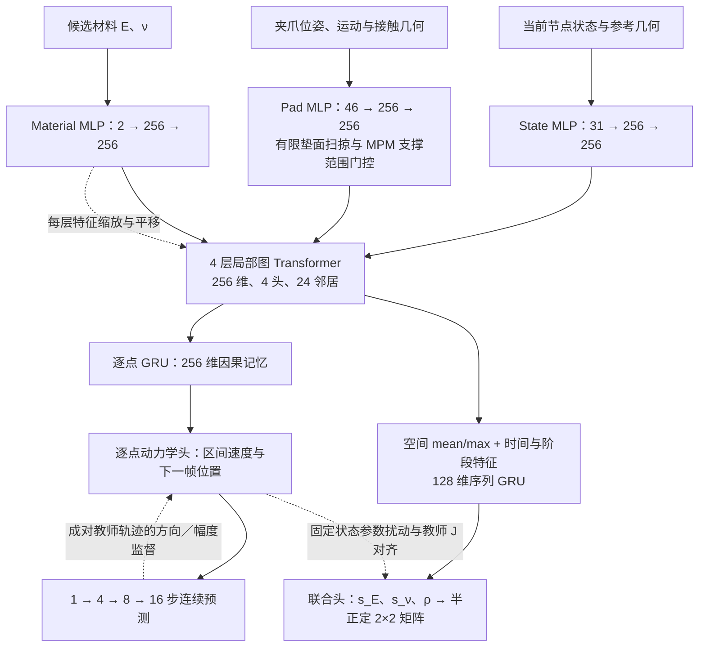

# CVPR27softdynamics

当前版本：**保留 MPM 教师训练的局部图 Transformer、因果 GRU 和 E、ν 联合敏感度头，新增由真实 GT 训练的逐步速度残差分支及联合 CMA-ES 校准**。本次代码更新日期为 **2026-11-11**。旧模型默认行为兼容；残差版本使用独立数据清单、训练入口和检查点。

残差从零初始化，以 m/s 限幅，每步校正运动量并反馈到下一步。第一阶段冻结基础模型和敏感度头，只更新残差。MPM 损失继续监督未校正分支，真实 GT 监督校正分支。完整接口与命令见 [真实 GT 残差校正](docs/real_residual_20261111.md)。当前实现是神经代理的残差扩展，保留原有 F/C 接口语义，没有新增 MPM 网格积分或硬接触保证。

原 MPM 基础训练使用固定的 **2,985 条训练轨迹与 320 条验证轨迹**，280 条已完成测试轨迹不参与训练、校准或选模。下面的图和规模表描述保留的基础模型；残差效果须以新运行的真实 GT 验证结果为准。



动力学使用当前状态及最多 3 帧过去状态初始化记忆，之后反馈自己的预测；评分分支使用有掩码的观测交互序列。两者共享空间编码器，并通过有教师监督的局部材料响应联系。固定状态局部响应与整段轨迹响应采用不同损失，不混用标签。

| 项目 | 当前实现 |
|---|---|
| 动力学节点 | 512 个，参考几何中各取 24 个邻居 |
| 网络规模 | 3,632,614 个参数，其中动力学与因果记忆 3,328,787 个 |
| 时间建模 | 动力学逐点 GRU；评分分支时间／阶段特征 + 序列 GRU |
| 材料范围 | E：1,000–12,000 Pa；ν：0.08–0.42 |
| 预测协议 | 40,000 次更新，1,000／4,000／10,000 步后依次切换到 4／8／16 步预测 |
| 评分含义 | 对 E、ν 的局部运动敏感度，不是材料值或预测正确概率 |
| 联合评分 | 响应强度与方向相关性；输出半正定矩阵，不是材料参数的统计先验 |
| 教师标签 | 排除 shirt 后，49 个物体 × 10 段 × 8 组材料＝3,920 份目标标签 |
| 选模 | 固定验证集的 16 步位置误差、局部／整段材料响应误差和短预算参数恢复诊断 |

详细模块、损失和验证范围见 [连续预测与联合响应](docs/coupled_training_20261110.md)。[独立单步版本](docs/model_architecture_20261110.md)保留为历史基线。

## 安装与检查

从源码 checkout 安装，Python >= 3.10。物理教师需要匹配驱动的 CUDA/PyTorch，Warp 固定为 1.8.1。

```bash
python -m venv .venv
source .venv/bin/activate
pip install -e '.[physics,deform360,search,report,test]'
CUDA_VISIBLE_DEVICES='' OMP_NUM_THREADS=2 MKL_NUM_THREADS=2 python -m pytest -q
```

无需实验数据或 GPU 即可实例化当前网络：

```python
import json
from softdynamics.coupled_world_model import CoupledWorld

with open('configs/teacher50_current.json') as f:
    config = json.load(f)
model = CoupledWorld(config['model'], tau=[1., 1.])  # 实际 tau 仅由训练集校准
print(sum(p.numel() for p in model.parameters()))
```

## 当前流程入口

| 环节 | 代码 |
|---|---|
| 当前物理与网络配置 | [configs/teacher50_current.json](configs/teacher50_current.json) |
| 教师 B 定义和动作契约 | `softdynamics/teacher_contact.py` |
| 网络接触作用范围 | `softdynamics/teacher_contact_support.py` |
| 标签准备与生成 | `softdynamics/teacher50.py`、`elastic_data.py` |
| 当前连续训练 | `softdynamics/coupled_world_train.py` |
| 固定真实 GT、绑定与支持／留出划分 | `softdynamics/real_residual_data.py` |
| 校正递推、可见性损失与残差正则 | `softdynamics/real_residual_objective.py` |
| 冻结基础模型的残差训练、联合 CMA-ES | `softdynamics/real_residual_train.py` |
| 共享骨干、因果记忆与联合头 | `shared_world_model.py`、`coupled_world_model.py` |
| 数据快照、成对轨迹与局部响应 | `softdynamics/coupled_world_data.py` |
| 连续验证与材料恢复诊断 | `softdynamics/coupled_world_validation.py` |
| 历史单步训练与搜索 | `elastic_world_train.py`、`elastic_world_search.py` |
| 教师加速 | `bound_observation.py`、`runtime/gs-layer/active_grid_kernels.py`、`deterministic_transfer.py` |
| 保持坐标的扩域、细网格重试 | `numerical_retry_rectangular.py`、`rectangular_grid.py`、`numerical_retry_spatial.py`、`spatial_grid.py` |

对已准备好、来源一致的教师批次，可显式准备训练再启动：

```bash
python -m softdynamics.coupled_world_train prepare \
  --data-root /path/to/immutable_teacher_snapshot --output /path/to/new_training_run
CUDA_VISIBLE_DEVICES=0 python -m softdynamics.coupled_world_train train \
  --output /path/to/new_training_run
```

准备入口冻结数据清单并检查接触、动作与标签一致性。默认从头训练 40,000 次更新，仅保存 `best.pt` 和 `latest.pt`。当前训练入口使用单张 CUDA 卡。`--resume` 恢复本次运行的模型、优化器和随机数状态。

```python
from softdynamics.coupled_world_model import load_coupled, forecast
model, bundle = load_coupled('/path/to/new_training_run/training/best.pt', 'cuda:0')
model.eval()
# batch 由 temporal_batch 构造；输入为归一化状态、动作和过去历史。
# forecast(model.world, batch, geometry, gradients=True) 保留预测段内的材料梯度。
```

新检查点使用独立 schema；旧 `elastic_world_search` 的单步检查点入口不适用。原耦合版本提供验证集短窗口参数拟合；残差版本另提供完整真实支持交互上的联合 CMA-ES。原始 MPM 复演仍需单独执行与验证，不能从训练损失推断真实效果。

数据、动作、标签、权重和集群连接配置由运行环境提供。本快照保留实验来源路径与哈希；迁移完整采集批次前须按 [发布说明](docs/release_20261110.md) 核对外部输入。

## 接触与数据约定

- 教师使用 64×25 mm 有限垫面、单边接触及库仑摩擦。多接触速度修正取平均的已知行为仍与选定 B 方案一致。
- 动作通过源代码插值与端点保持补齐，保留单／双夹爪任务定义，没有增加姿态质量门槛。
- 网络对齐有限垫面扫掠及 MPM 插值支撑范围，接触响应由网络学习，没有硬性不穿透保证。
- 修复时同一交互的 8 组标签采用一致几何、时间步和网格设置。数值通过与物理逼真度分别评价。
- 当前只搜索 E、ν，摩擦和阻尼沿用教师设置。仓库保留旧四参数接口供历史复现。

[2026-10 基线流程](docs/baseline_pipeline_20261028.md) · [数据接口](docs/data_contract.md) · [来源与许可证](THIRD_PARTY.md) · [初始单步源码快照哈希](docs/source_snapshot_20261110.json)

`runtime/empm/` 及派生研究运行时遵循所附上游研究许可证，根目录许可证不覆盖第三方条款。
